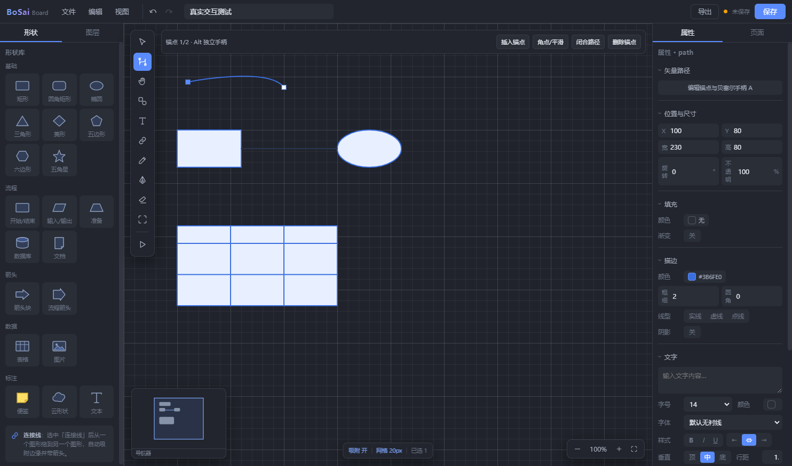

<div align="center">


# BoSai Board

### 面向专业图示与工程建模的本地桌面白板

用一张画布整理流程、数据与系统结构。支持从自由绘制到结构化建模，工程文件保存在本机。

<p>
  
  
  
  
</p>

[功能特性](#功能特性) · [快速开始](#快速开始) · [开发与验证](#开发与验证) · [支持范围](#支持范围)

</div>

<p align="center">
  
</p>

## 项目简介

BoSai Board 是一款使用 Electron、React 和 TypeScript 构建的桌面图示工具。它将无限画布编辑与工程模型组织放在同一个本地工作流中，适合绘制流程图、ER 图、数据流图、类图、时序图和常见系统设计图。

项目以**单人、本地使用**为方向。`.bosai` 是原生工程格式；打开和保存工程不依赖云端账号。完整替代 Visio 是长期目标，当前仍有明确的功能边界，见[支持范围](#支持范围)。

## 功能特性

| 画布与绘图 | 工程建模 | 文件与安全 |
| --- | --- | --- |
| 无限画布、缩放、平移、网格与智能吸附 | 用例、DFD、ER、类图、时序图等专用符号 | `.bosai` 原生工程保存与打开 |
| 矩形、流程符号、表格、文本、便签、钢笔与路径编辑 | 结构化属性、关系、规则、数据字典与模型追踪 | 自动恢复快照、原子保存与版本迁移 |
| 连线自动吸附，支持直线、正交线和曲线 | 模型与页面视图分离，支持模型复用 | 本机处理；可选 AI 草稿默认关闭 |
| 多选、组合、对齐、图层、多页面与撤销重做 | 通用模板优先，具名业务模板作为可选示例 | 导入前校验；不覆盖导入源文件 |

### 导出与格式

- 图片导出：PNG、WebP、JPG/JPEG、BMP，支持倍率、背景和导出范围设置。
- 矢量导出：SVG；也可以打印或另存为 PDF。
- 外部导入：SVG、VSDX、draw.io、SQL、文本与部分源码格式，具体转换范围因格式而异。
- 原生文档：当前版本为 2；可读取版本 1 并迁移到内存中的版本 2。迁移后的文档在显式保存前不会改写源文件。

导入是有限转换，不等同于完整兼容原格式。导入前会提示可能的转换损失，并将结果另存为 `.bosai` 工程。

## 快速开始

### 环境要求

- Node.js 与 npm
- Windows x64 可生成安装版和便携版；本地开发需要可运行 Electron 的桌面环境。

### 安装并运行

```bash
git clone https://github.com/Daxz333/bosai-board.git
cd bosai-board
npm ci
npm start
```

`npm start` 会先构建前端，再启动桌面应用。开发时可使用热更新模式：

```bash
npm run dev
```

### 打包 Windows 应用

```bash
npm run dist
```

安装版和便携版输出到 `release/`。打包配置面向 Windows x64；运行 `npm start` 不会更新安装包。

## 开发与验证

```bash
npm ci                 # 安装锁文件对应的依赖
npm run typecheck      # TypeScript 类型检查
npm run build          # 构建前端
npm test               # 运行 Electron 集成测试
npm run check          # 类型、主进程语法、构建和全部已注册测试
```

`npm test` 使用 `dist/index.html`，因此单独运行测试前要先构建最新源码；`npm run check` 已按正确顺序执行这些检查。

### 主要目录

```text
src/          React 界面、画布交互、文档状态与图形引擎
electron/     桌面主进程、preload、安全 IPC 与文件操作
tools/        集成测试、开发辅助、截图与诊断脚本
assets/       应用图标与 README 预览图
public/       前端静态资源
```

## 支持范围

BoSai Board 仍在持续开发中。以下边界有助于判断它是否适合当前工作流：

- VSDX、SVG、draw.io、SQL、源码等外部格式只支持部分内容转换；当前不支持 VSDX 导出。
- 暂无自动布局、泳道和跨页连接线。
- 暂无云端同步与多人协作；工程默认保存在本机。
- 可选 AI 草稿由用户显式启用和触发，不会默认上传当前工程。

## 参与项目

欢迎通过 [GitHub Issues](https://github.com/Daxz333/bosai-board/issues) 反馈问题或提出改进建议。提交问题时，请附上复现步骤、预期结果和实际结果；分享工程文件前请先移除敏感内容。

---

<div align="center">

**BoSai Board** · 本地优先的专业图示与工程建模工具

</div>
